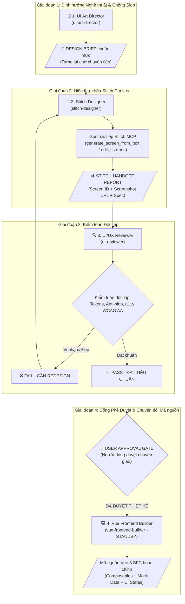

# Kiến Trúc Nhóm AI Agent Thiết Kế Giao Diện EduSense (UI Redesign Team)

## 1. TỔNG QUAN VÀ ĐỊNH HƯỚNG PHASE-GATED ENGINEERING
Nhóm AI Agent UI được thiết lập để thực hiện nhiệm vụ **thiết kế lại (redesign) và tối ưu hóa các trang trên Google Stitch** theo nguyên tắc **Phase-gated engineering** (kỷ luật theo từng giai đoạn kiểm soát):
- **Kiểm soát chặt chẽ visual trên Stitch Canvas trước**: Chặn trước nguy cơ agent tự ý chuyển sang code Vue hoặc tự ý biến tấu `DESIGN.md`.
- **Kế thừa và nâng cấp 22 màn hình hiện có trên Google Stitch Project** (`12694985645523425274`).
- **Khử bỏ AI generic / AI slop**: Triệt tiêu các thẻ card bo góc vô tội vạ, mảng gradient trang trí vô nghĩa, badge pill thừa thãi, căn giữa 3 dòng rập khuôn; hướng tới phong cách học thuật cao cấp Material 3 Academic.
- **Standby cho Vue Builder**: Chỉ khi màn hình đạt chứng chỉ kiểm toán độc lập `[PASS - ĐẠT TIÊU CHUẨN THIẾT KẾ]` và có lệnh phê duyệt từ Người dùng, `vue-frontend-builder` mới được kích hoạt bóc tách mã nguồn Vue 3 SFC.

---

## 2. QUY TRÌNH 4 GIAI ĐOẠN KIỂM SOÁT (PHASE-GATED WORKFLOW)

---

## 3. PHÂN CÔNG VAI TRÒ & RÀNG BUỘC CỦA BỘ 4 PROMPTS KÍCH HOẠT

### 🎨 Conversation 1: `ui-art-director`
- **Trạng thái:** Kích hoạt ĐẦU TIÊN.
- **Nhiệm vụ:** Phân tích giao diện hiện có, chỉ ra ít nhất 3 điểm yếu/AI slop và soạn Design Brief chuẩn mực.
- **Ràng buộc:** Tuân thủ tuyệt đối `docs/DESIGN.md`, KHÔNG viết code, KHÔNG tự ý sửa file `DESIGN.md`.
- **Đầu ra:** Bản **DESIGN BRIEF** (Mục tiêu, Vấn đề cần giải quyết, Bố cục phân khu, Design Tokens áp dụng, Anti-slop Guardrails, Yêu cầu đối với Stitch Designer) và **DỪNG LẠI**.

### 📐 Conversation 2: `stitch-designer`
- **Trạng thái:** Kích hoạt SAU KHI CÓ DESIGN BRIEF.
- **Nhiệm vụ:** Nhận brief, áp dụng kỹ năng `enhance-prompt`, gọi trực tiếp công cụ Stitch MCP trên project `12694985645523425274`.
- **Ràng buộc:** Thực sự gọi công cụ Stitch MCP (không nói suông), không tự ý đổi token màu/font.
- **Đầu ra:** Bản **STITCH HANDOFF REPORT** (Trạng thái MCP, Stitch Screen ID, Screenshot URL, Enhanced Prompt, Đặc tả bố cục thực tế) và **DỪNG LẠI**.

### 🔍 Conversation 3: `ui-reviewer`
- **Trạng thái:** Kích hoạt SAU KHI STITCH DESIGNER BÀN GIAO.
- **Nhiệm vụ:** Kiểm toán độc lập dựa trên WCAG AA, tính rõ ràng học thuật và `docs/DESIGN.md`.
- **Ràng buộc:** Khách quan độc lập, KHÔNG tự ý chỉnh sửa code/canvas, kết luận dứt khoát.
- **Đầu ra:** Bản **UI/UX AUDIT REPORT** kèm quyết định `[FAIL - CẦN REDESIGN TRÊN STITCH]` hoặc `[PASS - ĐẠT TIÊU CHUẨN THIẾT KẾ]`.

### 💻 Conversation 4: `vue-frontend-builder`
- **Trạng thái:** CHẾ ĐỘ CHỜ (STANDBY) — Chỉ kích hoạt khi Người dùng đã duyệt thiết kế đạt chuẩn kèm Screen ID.
- **Nhiệm vụ:** Chuyển đổi Stitch HTML sang Vue 3 SFC (`<script setup lang="ts">`, Tailwind CSS).
- **Ràng buộc:** Tuyệt đối không sinh mã React, bóc tách riêng Composables & Mock Data vào thư mục riêng, đủ 4 UI States (Loading, Empty, Error, Data).
- **Đầu ra:** Cây thư mục component, mã Vue 3 SFC, mock data composable, hướng dẫn test.

---

## 4. BẢNG TRA CỨU HIỆN TRẠNG MÀN HÌNH TRÊN STITCH (`12694985645523425274`)

Dưới đây là danh sách các màn hình hiện có sẵn trên project để phục vụ tra cứu Screen ID khi bắt đầu quy trình Redesign:

| STT | Tên Màn Hình Trên Stitch | Stitch Screen ID | Phân nhóm chức năng |
|---|---|---|---|
| 1 | EduSense - Trang chủ | `c7b98073e77d4fe99fa027fd987a260e` | Dashboard & Tổng quan học tập |
| 2 | EduSense - Đăng nhập | `7f027bf6a1b643cf972702aea7876dad` | Xác thực & Tài khoản |
| 3 | EduSense - Đăng ký tài khoản | `4eb08baf5ae14df8b175ef67003e90a7` | Xác thực & Tài khoản |
| 4 | EduSense - Quên mật khẩu | `f70e3fab31a5452a8bc7cd1c35abc143` | Xác thực & Tài khoản |
| 5 | EduSense - Hồ sơ cá nhân | `bb9d830183ac4d2e992095c95dc6df1c` | Tài khoản & Thông tin cá nhân |
| 6 | EduSense - Bảo mật & mật khẩu | `2c6f15f203b9483ba10125d1fc00e7f4` | Cài đặt & Bảo mật |
| 7 | EduSense - Lịch | `4d56205002e4480bb73a122412f41aab` | Lập lịch & Thời khóa biểu |
| 8 | EduSense - Lịch thi | `6eed30e1d54b4f64a6f366528cdfca88` | Lập lịch & Kế hoạch thi |
| 9 | EduSense - Kế hoạch | `d84e2f0689a640f0a658cfcf8e325e67` | Kế hoạch học tập cá nhân |
| 10 | EduSense - Môn học | `cbc8ada643674faeb34a2bd23026c917` | Quản lý học phần |
| 11 | EduSense - Tài liệu | `3983eed49be44736937cb2646e2988c6` | Kho tài liệu học tập |
| 12 | EduSense - Tóm tắt tài liệu | `2afde226f40948babf3de26c30716103` | Tính năng AI: Summarization |
| 13 | EduSense - Bài tập | `17c0dbb11e2342f8aed7ab8d00a60c33` | Luyện tập & Quản lý bài tập |
| 14 | EduSense - Câu hỏi ôn tập | `9d601507d9a04ee4a9e5e6c35d96e1e7` | Ngân hàng câu hỏi tự luyện |
| 15 | EduSense - Trợ lý AI | `3310ba9da0074383970c5ba14434a174` | Chatbox AI tương tác |
| 16 | EduSense - Hạn mức sử dụng AI | `0fc348e9fceb474291956a3ae4276722` | Theo dõi AI Quota |
| 17 | EduSense - Thông báo | `f5f0bfb994d04b2499a5dac6ff5450f4` | Hệ thống thông báo học tập |
| 18 | EduSense - Cài đặt giao diện | `f1701cef26c2420ab8b24326597a723a` | Tuỳ biến cá nhân |
| 19 | EduSense - Cài đặt Thông báo | `6867b583264b482a88572f9e7174c568` | Cài đặt nhắc nhở |
| 20 | EduSense - Quản trị: Người dùng | `4b3a3f3e04d74fce9bf42ed4c126e302` | Quản trị viên hệ thống |
| 21 | EduSense - Quản trị: Thống kê & hạn mức AI | `0b185f7485d141d8a103ff907a61af7b` | Quản trị AI & Giám sát |
| 22 | EduSense - AI Learning Support Landing Page | `c10ce03b366a489ba4524d935a81e70f` | Trang giới thiệu sản phẩm |

---

## 5. CÁC MÀN HÌNH BỔ SUNG ĐẶC THÙ CẦN THIẾT KẾ MỚI (NEW SCREENS)
1. **AI Essay Grading & Rubric Details (Chấm bài tự luận bằng AI theo Rubric)**:
   - Căn cứ: `AGENTS.md §7`. Khung phân tích điểm thành phần (Luận điểm, Minh chứng, Trình bày), trích dẫn tài liệu tham chiếu (citations).
2. **Interactive Split-View Document Reader + RAG Q&A (Đọc tài liệu chia đôi màn hình)**:
   - Căn cứ: `ai-rag.md`. Cột trái hiển thị tài liệu/PDF, cột phải hội thoại AI, click citation nhảy đúng vị trí trang.
3. **Focus Practice & Flashcard Mode (Luyện tập tập trung)**:
   - Căn cứ: Trải nghiệm ôn luyện không xao nhãng, lật thẻ flashcard, đếm thời gian.
